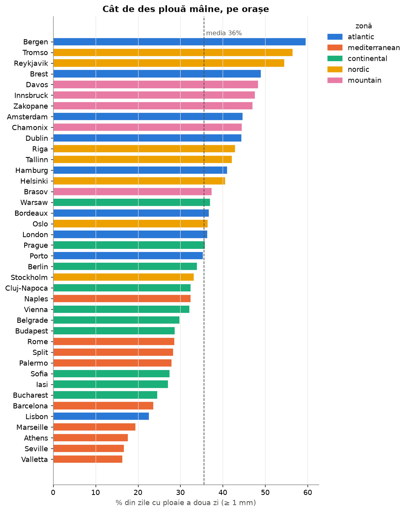
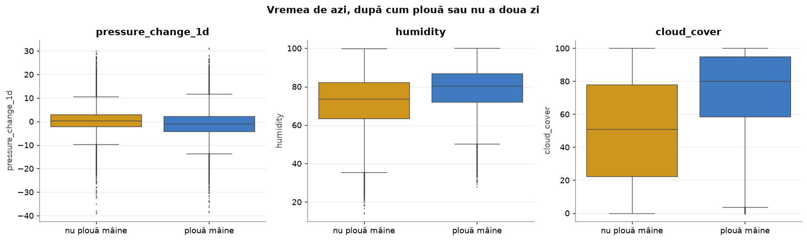
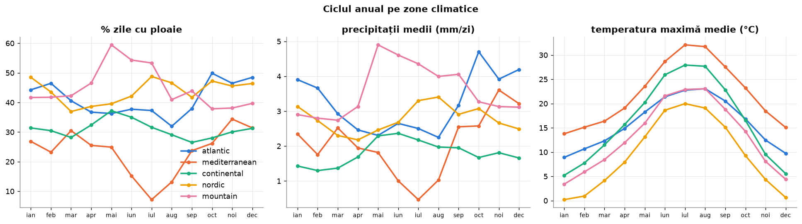

# Predicția ploii și a temperaturii în orașe europene

Proiect Data Mining. Construim un dataset propriu de vreme zilnică pentru **40 de orașe europene (2020–2025)** și
prezicem vremea de **a doua zi**:

- **clasificare:** plouă mâine? (`ploua_maine` = precipitații ≥ 1 mm)
- **regresie:** temperatura maximă de mâine (`temp_max_maine`, °C)

## 1. Datasetul

| | |
|---|---|
| Sursă | [Open-Meteo Historical Weather API](https://open-meteo.com/en/docs/historical-weather-api) (reanaliză ERA5), licență CC BY 4.0 |
| Orașe | 40, din 5 zone climatice: atlantic, mediteranean, continental, nordic, montan (`data/cities.csv`) |
| Perioadă | 2020-01-01 .. 2025-12-31, zilnic |
| Dimensiune | **87.400 de rânduri × 51 de features** (+ 6 coloane de identificare + 2 ținte) |
| Fișier | `data/processed/weather_dataset.csv` |

Un rând = un oraș într-o zi. Datasetul nu e preluat de undeva: e construit de scripturile din `src/`:

- `src/collect.py` face o cerere API per oraș și salvează răspunsul brut în `data/raw/`;
- `src/build_dataset.py` agregă datele orare, calculează features-urile și țintele și elimină rândurile incomplete
  (primele 6 zile, fără istoric de 7 zile, și ultima zi, fără țintă).

Rezultat: **0 valori lipsă**.

### Cum se rulează

```bash
pip install -r requirements.txt
python src/collect.py        # descarcă datele (o dată; scriptul așteaptă singur la limitele API-ului)
python src/build_dataset.py  # construiește data/processed/weather_dataset.csv
```

## 2. Features (51)

Toate features-urile descriu **ziua curentă sau zilele trecute**; țintele descriu **ziua următoare**.

| Grup | Nr. | Coloane |
|---|---|---|
| Vremea zilei, din API | 11 | `temp_max`, `temp_min`, `temp_mean` (°C), `precip` (mm), `precip_hours` (h), `wind_speed_max`, `wind_gusts_max` (km/h), `wind_dir` (°), `radiation` (MJ/m²), `sunshine_hours` (h), `weather_code` (cod WMO) |
| Medii zilnice calculate de noi din date orare | 3 | `pressure` (hPa), `humidity` (%), `cloud_cover` (%) |
| Orașul | 3 | `latitude`, `longitude`, `elevation` (m) |
| Calendar | 4 | `month`, `day_of_year`, `doy_sin`, `doy_cos` (ziua din an codificată ciclic) |
| Transformări | 4 | `wind_dir_sin`, `wind_dir_cos` (direcția vântului ciclic), `temp_range` (max − min), `rain_today` (0/1) |
| Lag-uri: valoarea de acum 1, 2, 3 zile | 18 | `<var>_lag1/2/3` pentru `temp_max`, `temp_min`, `precip`, `pressure`, `humidity`, `cloud_cover` |
| Ferestre pe ultimele 7 zile | 6 | `temp_mean_mean_7d`, `pressure_mean_7d`, `humidity_mean_7d`, `cloud_cover_mean_7d`, `precip_sum_7d`, `rain_days_7d` |
| Variații față de ieri | 2 | `pressure_change_1d`, `temp_max_change_1d` |
| **Total** | **51** | |

Coloane care **nu** sunt features: `city_id`, `city`, `country`, `zone`, `date`, `year` (identificare) și
`precip_maine` (doar pentru verificare).

## 3. Analiză exploratorie (pe scurt)

- **Dezechilibrul claselor:** 35,6% din zile sunt urmate de ploaie, deci un raport ~64/36. Variază mult între
  orașe: de la ~16% (Valletta, Sevilla) la ~59% (Bergen).

  

- **Semnale de ploaie:** înaintea unei zile ploioase presiunea tinde să scadă, iar umiditatea și nebulozitatea
  sunt mai mari.

  

- **Sezonalitate:** zonele au cicluri diferite: vară foarte uscată în zona mediteraneană (~7% zile cu ploaie în
  iulie), maxim toamna–iarna în zona atlantică, maxim în mai în zona montană.

  

- **Calitatea datelor:** extremele sunt evenimente reale (45,3 °C la Sevilla în iulie 2022, rafale de 148 km/h la
  Brest în noiembrie 2023), deci nu eliminăm valori.

- **Reperul de bătut:** regula „mâine = azi” dă F1 = 0,58 pentru ploaie și o eroare medie (MAE) de 1,97 °C pentru
  temperatură (an 2024). Modelele trebuie să facă mai bine de atât.

## 4. Algoritmii aleși

**Random Forest:** antrenează sute de arbori de decizie, fiecare pe un eșantion diferit din date și pe un
subset aleator de features; predicția finală e votul (clasificare) sau media (regresie) arborilor.
Combinarea mai multor arbori reduce supra-învățarea unui singur arbore.

**XGBoost (gradient boosting):** construiește arborii unul după altul; fiecare arbore nou învață să corecteze
erorile arborilor de dinainte. De obicei e cel mai precis model pe date tabulare.

De ce acești doi:
- funcționează bine pe date tabulare, cu features de tipuri și scări diferite, fără scalare;
- prind relații neliniare și interacțiuni (de exemplu, aceeași presiune înseamnă altceva vara și iarna);
- arată importanța features-urilor, deci putem explica ce contează pentru predicție;
- sunt două abordări diferite de a combina arbori (în paralel vs. secvențial), deci comparația are sens.

Amândoi se folosesc pentru ambele ținte (clasificare și regresie).

**Evaluare:**
- împărțire în timp: antrenare 2020–2023, validare 2024, test 2025 (o împărțire aleatoare ar lăsa modelul să
  „vadă” zile vecine cu cele din test);
- metrici: F1 și ROC-AUC pentru ploaie (acuratețea e înșelătoare: „nu plouă niciodată” are deja 64%), MAE și RMSE
  pentru temperatură;
- comparație cu reperul „mâine = azi”.

## Limitări

Datele sunt de reanaliză (model pe o grilă de ~25 km), nu măsurători de la stații meteo. Pentru orașele montane,
altitudinea punctului de grilă poate diferi de cea a orașului.
